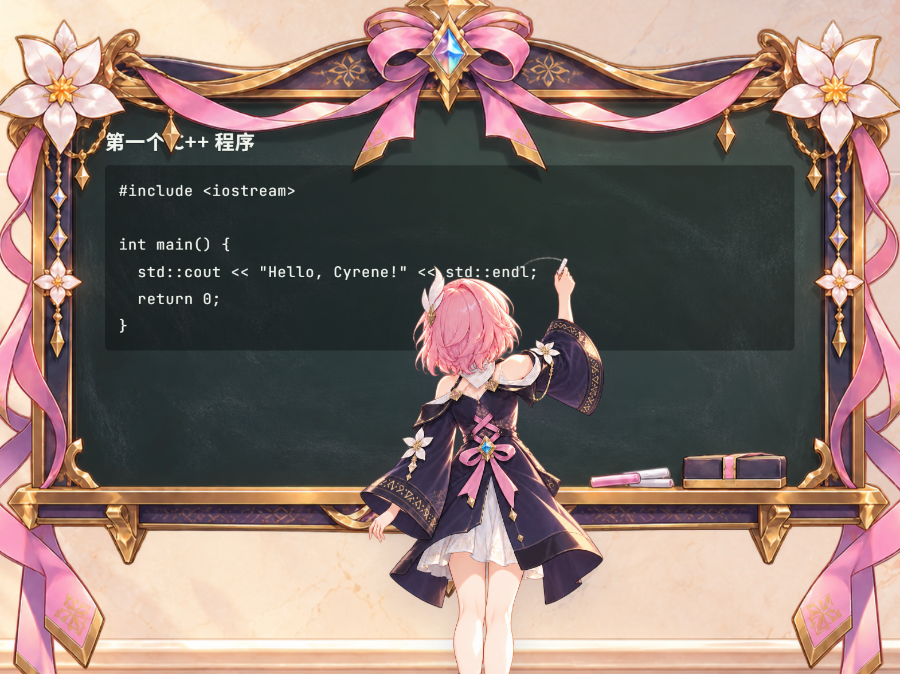

<div align="center">

# 神悟课堂 · better-lessons

把 learn 模式的对话式讲解，变成一间可以「演」出来的教室。




</div>

## 简介

**better-lessons** 是 Cyrene 的一个插件。在 learn 模式下，昔涟可以把要说的话写成一份**剧本（BLS）**，然后在一间独立的 视觉小说风格教室窗口里演出：教室背景、黑板、立绘与底部对话框，由**鼠标左键、空格或回车逐帧推进**。

剧本以纯文本文件的形式落在工作区的 `learn/lessons/` 下，因此课程可以被重放、被手工修改、被继续续写——文件就是唯一真相源。

## 特性

- **BLS 剧本文本格式**：全篇只有 `meta` / `say` / `board` 四个关键字，板书正文就是 markdown，写错了不会阻塞整堂课。
- **逐帧推进**：鼠标左键点击舞台，或按空格、回车，一次推进一个 step，节奏完全掌握在用户手里。
- **课堂插话**：直接在下方的聊天框里提问，昔涟可以写出新的一层剧本、打断当前播放、演完后**回到刚才那一步继续讲**，板书按断点瞬时重绘。
- **回放**：剧本留在 `learn/lessons/`，可以「重放本节」或「从头」重演整节课，全程不触发大模型。
- **公式与代码**：板书支持标准 markdown 与 LaTeX（`$...$` / `$$...$$`），行级动画与自动滚动跟随新内容。
- **立绘演出**：讲述 / 板书 / 擦板两帧交替，每次点击都是「走过去 → 停一下 → 走回来」的一次性造访。
- **自带全部素材**：教室、黑板、立绘都来自插件自己的 `assets/`，不读取宿主仓库的任何资源；素材缺失时退回纯 CSS 占位。
- **不碰笔记**：插件不生产、不读取、不写入任何笔记。

## 快速开始

1. 把本目录打包为 ZIP，在宿主的插件管理中导入；或在插件目录下直接放置本仓库文件夹。
2. 在插件列表中启用 **神悟课堂**（`better-lessons`，默认关闭）。
3. 进入 learn 模式并绑定一个工作区，然后请昔涟讲点什么，例如：

   > 给我讲讲判别式。

4. 昔涟会调用 `better-lessons_write_lesson` 写剧本、再用 `better-lessons_push_script` 推送，教室窗口自动打开。若窗口没开，也可以从插件列表的「打开」按钮进入，再用标题栏的 `📂 打开剧本` 自己挑一个 `.bls` 文件。

窗口默认占**左半屏**，右半边留给你放别的东西（例如 learn 模式写在 `notes/` 里的笔记）。标题栏的控件：

| 控件 | 作用 |
|---|---|
| `📂 打开剧本` | 用系统文件选择器挑剧本；单选 = 重放本节，多选 = 按文件名顺序当作一整节课 |
| `⟲ 本节` | 重放当前这一层 |
| `⟲ 从头` | 按播放列表顺序重演整节课 |
| `× 清空` | 清掉当前与待播剧本、板书和播放列表，回到开场状态；磁盘上的剧本文件保留 |
| \|◀ 回放 | 从左侧拉出回看抽屉，只看当前 BLS 已展示的对白；点击右侧空白处收起，不推进剧情 |

## BLS 速览

```bls
meta title=判别式

say <<
伙伴，我们今天只看一件事：**判别式**的符号。
>>
board <<
## 判别式

Δ = b² − 4ac
>>

say <<
它就是这条式子里的 Δ。
它的符号，直接决定抛物线与 x 轴交点的个数。
>>
board <<
> Δ > 0 → 两个交点
> Δ = 0 → 一个交点
> Δ < 0 → 没有交点
>>

board replace Δ < 0 → 没有交点 -> **Δ < 0 → 没有交点**
say <<
那 Δ < 0 的情况，图像长什么样？
>>
board clear
```

- `say <<` 块**一行一句**，每行是一个 step；`board <<` 块整块算一个 step。
- `board replace <旧内容> -> <新内容>` 按**内容匹配**定位，用来擦除、改写、强调，不需要写行号。
- `board clear` 清板；`->` 是唯一的分隔符，正文里要写箭头请用 `→`。
- 一个文件 = 一层剧本，文件名形如 `主题-序号-要点.bls`（如 `判别式-01-引入.bls`），补充内容用 `01.1`。

## 工具

| 工具 | 作用 |
|---|---|
| `better-lessons_write_lesson` | 把 BLS 正文写入 `learn/lessons/<file>`（同名覆盖；解析失败不写入，并回传行号） |
| `better-lessons_push_script` | 按文件名读取剧本并推送演出（默认打断当前播放） |
| `better-lessons_lesson_list` | 列出 `learn/lessons/` 下的剧本文件 |
| `better-lessons_status` | 查询课堂状态：是否开着、当前文件、第几步、板书全文 |
| `better-lessons_close` | 关闭课堂窗口 |

此外插件会注册一个 **Prompt Provider**，在 learn 模式的每一轮把 BLS 格式说明与课堂现场（进度、板书全文、已用过的剧本清单）送到模型眼前。是否动用课堂由模型自己决定；唯一强制的一条是：模型写了剧本却忘了推送时，替它推出去。

## 配置、权限与数据

- 插件默认关闭，启用后无需密钥或额外配置。模型生成和保存剧本需要 learn 模式及已绑定的可写工作区；手动从本机选择已有 `.bls` 文件可直接播放。
- 清单只声明 `workspace` 能力，用于定位会话工作区。插件读写该工作区的 `learn/lessons/*.bls`；通过系统文件选择器手动选中的剧本，也会从所选路径读取。`× 清空` 不删除磁盘文件。
- 播放队列、光标、板书、回看对白、所选剧本路径和窗口偏好通过宿主 `ctx.storage` 保存在本机插件存储中，不写笔记，也不上传课堂内容。
- 主进程与课堂脚本不主动发起网络请求，也不启动子进程。课堂样式会向 Google Fonts 请求字体；断网时使用本机字体。本 README 的版本徽章图片仅在浏览文档时请求 shields.io。
- 对白和板书中的 Markdown 链接仅显示文字，不会打开网址；课堂渲染器禁用 Node 集成并启用隔离和沙箱，IPC 只经受限 preload 接口。

## 已知限制

- 插件窗口使用固定的宿主浅色配色，暂不能读取宿主主题或圆角偏好；窄窗口里立绘可能遮挡黑板右侧，板书区域可横向滚动。
- 课堂状态依赖本机插件存储；手动修改或删除剧本文件后，再次回放会按磁盘上的当前内容读取，读取失败会提示或跳过。

源码仓库：[Cyrene-Better-Lessons](https://github.com/yuzu-tanuki/Cyrene-Better-Lessons)。

## 项目结构

```
better-lessons/
├── manifest.json        # 插件清单：id better-lessons，version 0.1.0
├── index.cjs            # register / unregister / open：工具、Provider、事件、IPC、持久化
├── preload.cjs          # 隔离的课堂 IPC 白名单
├── prompts.cjs          # 全部给模型的措辞
├── bls.cjs              # BLS 解析器 + 校验器：文本 → IR + warnings
├── lessons.cjs          # learn/lessons/ 文件 IO：路径白名单、读写、列举
├── board.cjs            # Board 数据结构与 apply() 纯函数
├── rooms.cjs            # 房间注册表、帧队列、持久化纯函数
├── ui.html / ui.css     # galgame 主窗口：教室 / 黑板 / 立绘 / 对话框
├── panel.html           # 可选设置面板（manifest 暂未声明）
├── vendor/              # 单文件第三方库
└── assets/              # 全部美术素材
```

运行时产物：剧本写入 `<workspace>/learn/lessons/*.bls`；播放状态（帧队列、光标、板书）存在插件 storage 里，不写任何笔记文件。

## 第三方

`vendor/` 下为手工 vendored 的单文件构建，许可证副本与来源记录见 [LICENSES.md](vendor/LICENSES.md)：

| 库 | 用途 | 许可证 |
|---|---|---|
| [markdown-it](https://github.com/markdown-it/markdown-it) | 板书与对白的 markdown 渲染 | MIT |
| [KaTeX](https://github.com/KaTeX/KaTeX) | LaTeX 公式渲染 | MIT |
| [DOMPurify](https://github.com/cure53/DOMPurify) | HTML 净化（隔离渲染器仍须防止模型文本注入页面） | Apache-2.0 / MPL-2.0 |

## 许可证

[MIT](LICENSE) © 2026 yuzu_tanuki
